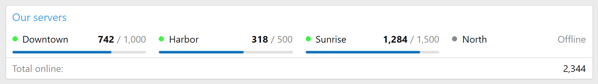
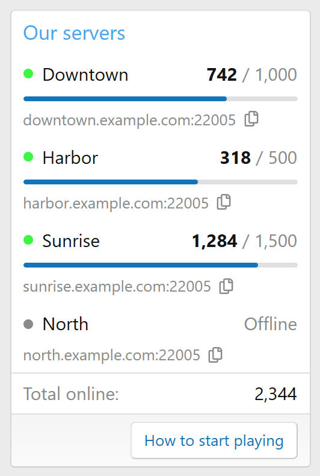
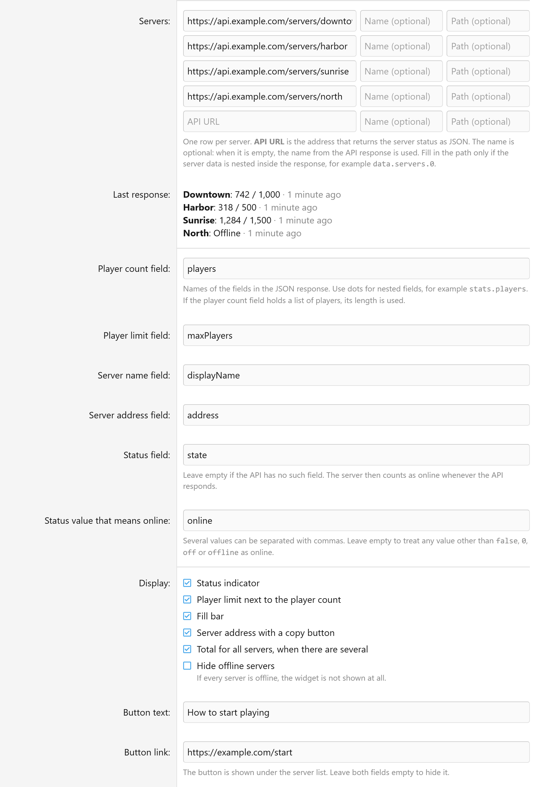

<div align="center">


# [nt] Server Online

A XenForo 2.3 widget with the player count of your game servers: players online, the limit, a fill bar and the address to connect to.

[](https://xenforo.com)
[](https://github.com/mityakuss-pixel/nt-server-online/releases/latest)
[](https://github.com/mityakuss-pixel/nt-server-online/releases)
[](LICENSE)

[Русский](README.md) · **English**

<picture>
	<source media="(prefers-color-scheme: dark)" srcset="docs/wide-dark.png">
	
</picture>

</div>

## Features

- **Reads a JSON API.** The add-on is not tied to a game: it needs an address that returns the server status as JSON and the names of the fields in the response.
- **Several servers in one widget**, up to 20, with an optional total under the list.
- **Status indicator.** A server is online according to a field in the response or, when there is no such field, as long as the API responds.
- **Player limit and a fill bar.**
- **Server address with a copy button.**
- **A link button** under the list, for example to a "How to start playing" page.
- **Any widget position.** Servers are stacked in the sidebar and placed in a row in wide positions.
- **Light and dark style variations.** Colors are set in style properties.

<div align="center">
<picture>
	<source media="(prefers-color-scheme: dark)" srcset="docs/sidebar-dark.png">
	
</picture>
</div>

## Performance

Forum pages never call the API. The widget reads ready data from the XenForo cache, and the requests run in the background.

- A cron entry refreshes the data once a minute; the interval is an option.
- Requests to different servers run in parallel. An address is requested once even if several widgets use it.
- The add-on waits 3 seconds for a response (configurable) and reads at most 1 MB.
- If the API does not respond, the widget keeps the last data for three intervals, but not less than three minutes. After that the server is shown as offline.
- The add-on adds no scripts of its own to the page.

## Requirements

- XenForo 2.3.0 or later.
- The API must be reachable from the server the forum runs on.

## Installation

1. Download `NT-ServerOnline-1.0.0.zip` from the [releases page](https://github.com/mityakuss-pixel/nt-server-online/releases/latest).
2. In the admin control panel open **Add-ons → Install/upgrade from archive** and choose the archive.
3. Add the widget as described below.

If there is no install from archive button, unpack the archive, upload the contents of the `upload` folder to the forum root and install the add-on from the **Add-ons** list. The same from the command line:

```bash
php cmd.php xf-addon:install NT/ServerOnline
```

## Widget setup

1. **Appearance → Widgets → Add widget**, definition **Game server online**.
2. Set the widget key, the title and the positions.
3. Paste the API URL into **Servers**. The name is optional: when it is empty, the name from the response is used.
4. Save. The add-on requests the API right away. If the response is not JSON or has no player count field, the form is not saved and tells you what is missing.

The default field names match a response like this:

```json
{
	"displayName": "Downtown",
	"address": "downtown.example.com:22005",
	"state": "online",
	"players": 742,
	"maxPlayers": 1000
}
```

If your API names the fields differently, change them in the widget options:

| Option | Default | What it holds |
|---|---|---|
| Player count field | `players` | A number, or a list of players whose length is used. Required |
| Player limit field | `maxPlayers` | Without it there is no limit and no fill bar |
| Server name field | `displayName` | Used when the name is not entered by hand |
| Server address field | `address` | The string players connect to |
| Status field | `state` | May be left empty |
| Status value that means online | `online` | Several values can be separated with commas |

Nested fields are written with dots: `stats.players`. If one address returns several servers at once, add a row for each of them and enter its path in the response, for example `data.servers.0` and `data.servers.1`.

<details>
<summary>Widget options form</summary>
<br>

</details>

## Options

**Setup → Options → [nt] Server Online**:

| Option | Default |
|---|---|
| Refresh interval | 60 seconds, from 60 to 3600 |
| Request timeout | 3 seconds, from 1 to 15 |

## Style properties

**Appearance → Style properties → [nt] Server Online**: the color of the online and offline indicators, the color and height of the fill bar. By default the colors come from the style palette.

The add-on does not edit core templates. The markup is in the `nt_server_online_widget` template, the styles are in `nt_server_online.less`.

## Uninstall

Uninstall it as usual from **Add-ons**. Its widgets, options, phrases, templates and the cache with server data are removed with it. The add-on creates no database tables.

## Development

The repository mirrors the forum root: the code and `_output` are in `src/addons/NT/ServerOnline`.

Copy the folder into a forum with development mode enabled, install the add-on and import `_output`:

```bash
php cmd.php xf-addon:install NT/ServerOnline
php cmd.php xf-dev:import --addon=NT/ServerOnline
```

Build a release:

```bash
php cmd.php xf-addon:build-release NT/ServerOnline
```

## License

[MIT](LICENSE)
