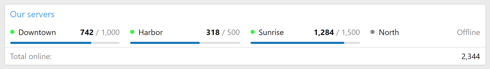
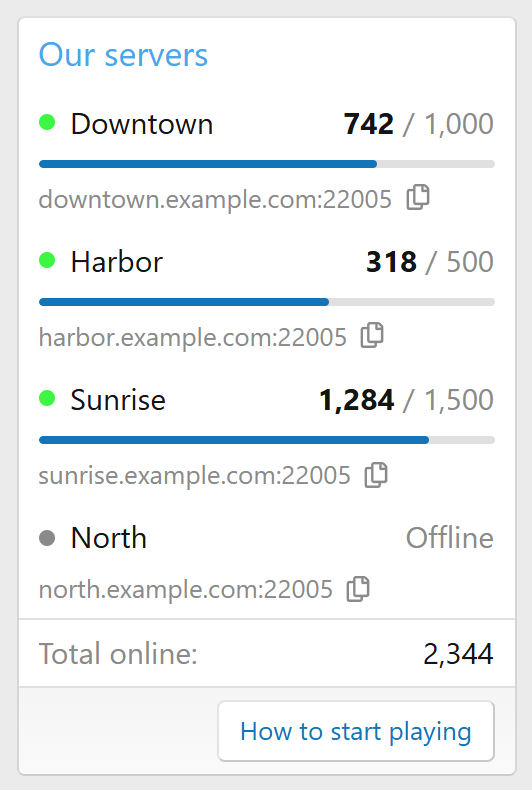
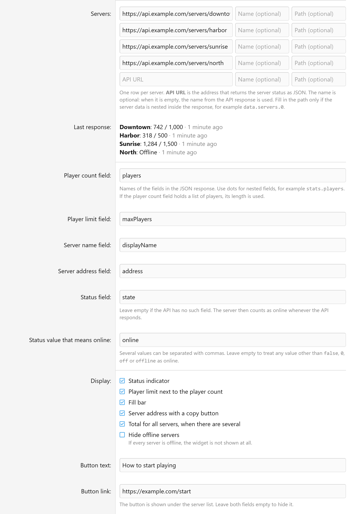

<div align="center">


# [nt] Server Online

Виджет для XenForo 2.3 с онлайном игровых серверов: сколько игроков сейчас, лимит, заполненность и адрес для подключения.

[](https://xenforo.com)
[](https://github.com/mityakuss-pixel/nt-server-online/releases/latest)
[](https://github.com/mityakuss-pixel/nt-server-online/releases)
[](LICENSE)

**Русский** · [English](README.en.md)

<picture>
	<source media="(prefers-color-scheme: dark)" srcset="docs/wide-dark.png">
	
</picture>

</div>

## Что умеет

- **Берёт данные из JSON API.** Плагин не привязан к игре: нужен адрес, который отдаёт состояние сервера в JSON, и имена полей в ответе.
- **Несколько серверов в одном виджете**, до 20. Под списком можно показать сумму онлайна.
- **Индикатор состояния.** Сервер считается работающим по полю из ответа, а если такого поля нет, по тому, отвечает ли API.
- **Лимит игроков и полоса заполненности.**
- **Адрес сервера с кнопкой копирования.**
- **Кнопка со ссылкой** под списком, например на страницу «Как начать играть».
- **Любая позиция виджетов.** В боковой панели серверы стоят столбиком, в широких позициях встают в ряд.
- **Светлая и тёмная вариации стиля.** Цвета меняются в настройках стиля.

<div align="center">
<picture>
	<source media="(prefers-color-scheme: dark)" srcset="docs/sidebar-dark.png">
	
</picture>
</div>

## Нагрузка

Страницы форума к API не обращаются. Виджет читает готовые данные из кэша XenForo, а запросы идут в фоне.

- Данные обновляет задание планировщика раз в минуту, интервал настраивается.
- Запросы к разным серверам идут параллельно. Один адрес запрашивается один раз, даже если он указан в нескольких виджетах.
- Ответ ждём 3 секунды (время настраивается) и читаем не больше 1 МБ.
- Если API не ответил, виджет ещё три интервала, но не меньше трёх минут, показывает последние данные. Потом сервер считается не в сети.
- Своих скриптов плагин на страницу не добавляет.

## Требования

- XenForo 2.3.0 или новее.
- API должен быть доступен с сервера, на котором стоит форум.

## Установка

1. Скачайте `NT-ServerOnline-1.0.0.zip` со [страницы релизов](https://github.com/mityakuss-pixel/nt-server-online/releases/latest).
2. В панели управления откройте «Плагины → Установить/обновить из архива» и выберите архив.
3. Добавьте виджет, как описано ниже.

Если кнопки установки из архива нет, распакуйте архив, загрузите содержимое папки `upload` в корень форума и установите плагин из списка в разделе «Плагины». То же из консоли:

```bash
php cmd.php xf-addon:install NT/ServerOnline
```

### Русский перевод

Плагин по умолчанию на английском. Перевод лежит в `NT-ServerOnline-1.0.0-ru.zip` на той же странице релизов.

1. Распакуйте архив, внутри файл `language-ru-NT-ServerOnline.xml`.
2. «Внешний вид → Языки → Импортировать язык», выберите файл и отметьте перезапись вашего русского языка.

## Настройка виджета

1. «Внешний вид → Виджеты → Добавить виджет», определение «Game server online» (в переводе «Онлайн игрового сервера»).
2. Задайте ключ виджета, заголовок и позиции.
3. В поле «Серверы» вставьте адрес API. Название можно не заполнять, тогда оно берётся из ответа.
4. Сохраните. Плагин сразу запросит API. Если в ответе пришёл не JSON или нет поля с числом игроков, форма не сохранится и скажет, чего не хватает.

Имена полей по умолчанию рассчитаны на такой ответ:

```json
{
	"displayName": "Downtown",
	"address": "downtown.example.com:22005",
	"state": "online",
	"players": 742,
	"maxPlayers": 1000
}
```

Если в вашем API поля называются иначе, поменяйте их в настройках виджета:

| Настройка | По умолчанию | Что в ней |
|---|---|---|
| Поле с числом игроков | `players` | Число или список игроков, тогда берётся его длина. Обязательное |
| Поле с лимитом игроков | `maxPlayers` | Без него не будет лимита и полосы заполненности |
| Поле с названием сервера | `displayName` | Нужно, если название не задано вручную |
| Поле с адресом сервера | `address` | Строка для подключения |
| Поле состояния | `state` | Можно оставить пустым |
| Значение состояния «в сети» | `online` | Несколько значений пишутся через запятую |

Вложенные поля пишутся через точку: `stats.players`. Если один адрес отдаёт сразу несколько серверов, добавьте по строке на каждый и укажите путь к нему в ответе, например `data.servers.0` и `data.servers.1`.

<details>
<summary>Форма настроек виджета</summary>
<br>

</details>

## Настройки плагина

«Настройки → Настройки → [nt] Server Online»:

| Настройка | По умолчанию |
|---|---|
| Интервал обновления | 60 секунд, от 60 до 3600 |
| Время ожидания ответа | 3 секунды, от 1 до 15 |

## Настройки стиля

«Внешний вид → Настройки стиля → [nt] Server Online»: цвет индикатора «в сети» и «не в сети», цвет и высота полосы заполненности. По умолчанию цвета берутся из палитры стиля.

Шаблоны ядра плагин не правит. Разметка лежит в шаблоне `nt_server_online_widget`, стили в `nt_server_online.less`.

## Удаление

Удаляется как обычно, в разделе «Плагины». Вместе с плагином уходят его виджеты, настройки, фразы, шаблоны и кэш с данными серверов. Своих таблиц в базе плагин не создаёт.

## Для разработчиков

Структура репозитория повторяет корень форума: код и `_output` лежат в `src/addons/NT/ServerOnline`.

Скопируйте папку в форум с включённым режимом разработки, установите плагин и импортируйте `_output`:

```bash
php cmd.php xf-addon:install NT/ServerOnline
php cmd.php xf-dev:import --addon=NT/ServerOnline
```

Собрать архив:

```bash
php cmd.php xf-addon:build-release NT/ServerOnline
```

## Лицензия

[MIT](LICENSE)
